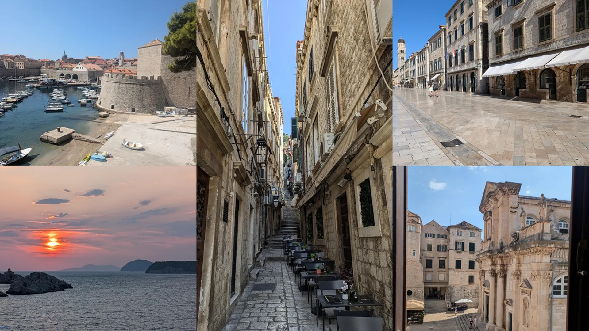
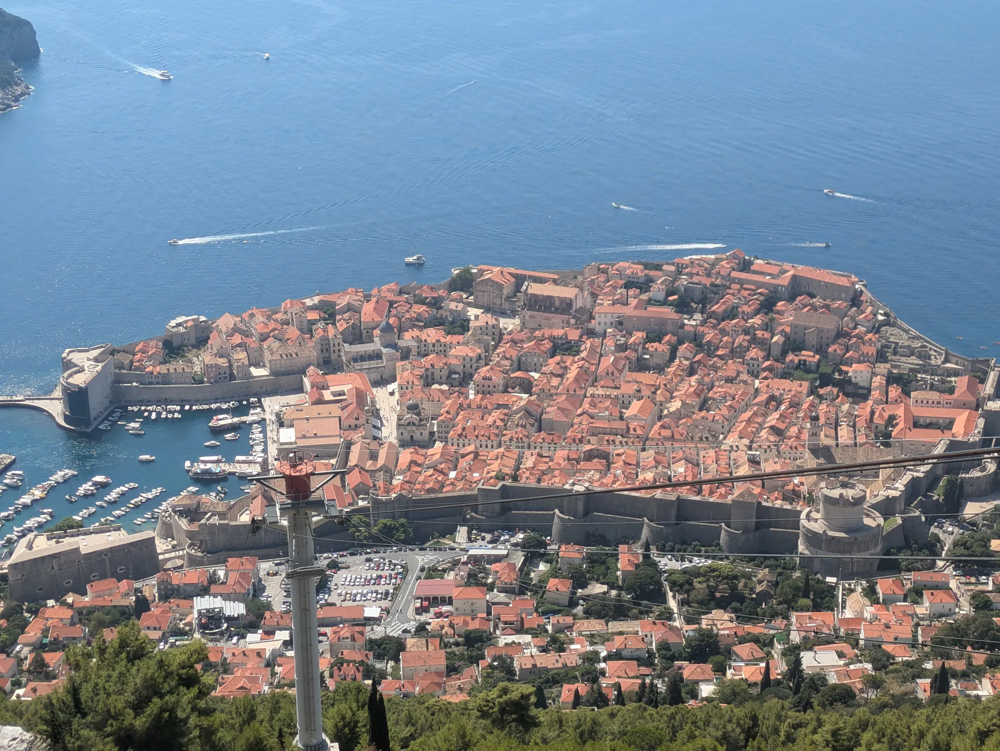
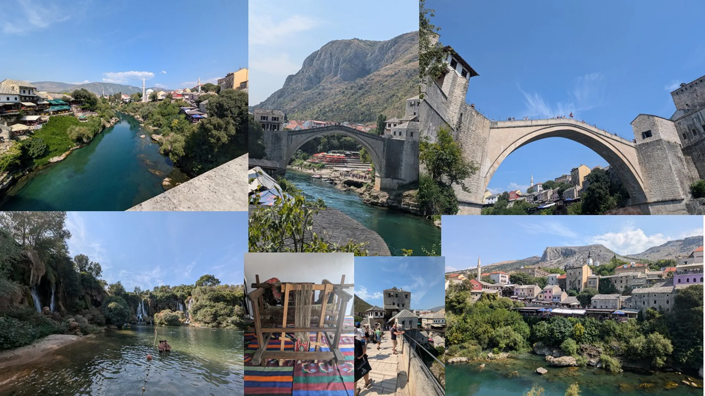
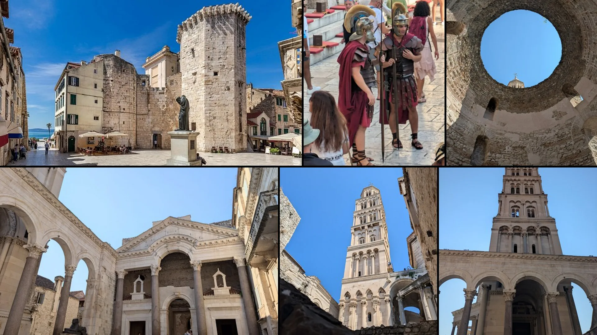
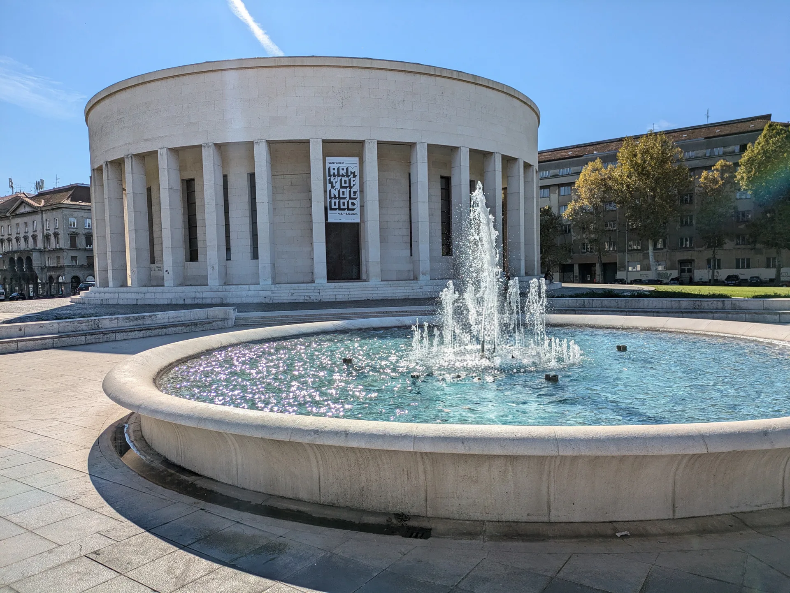
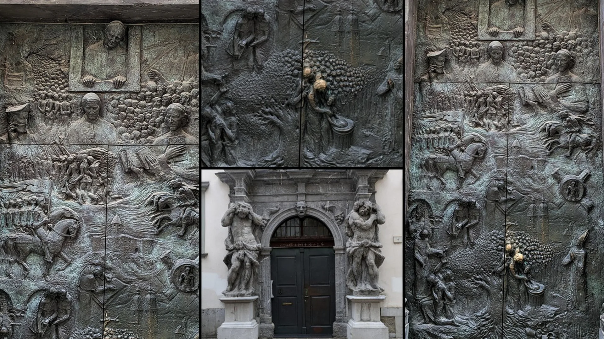
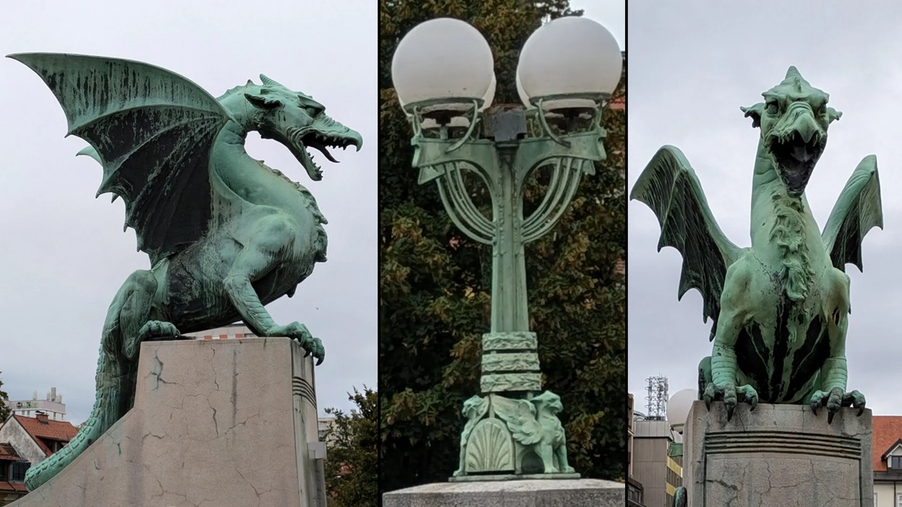

## Crossroads of Empires

Some journeys are defined by a single country. This one was shaped by the places in between.

The route followed coastlines, mountain passes, frontier towns, Roman cities, medieval ports, and former imperial capitals stretching across Croatia, Bosnia and Herzegovina, and Slovenia.

At first glance the destinations seemed unrelated. A walled Adriatic city. A bridge in Bosnia. Roman ruins. Venetian ports. Mountain lakes. Habsburg boulevards. Alpine villages.

Yet the farther the journey progressed, the more a common pattern emerged. Places revealed themselves as crossroads. Not endpoints. Connections. Between East and West. Between empires. Between religions. Between cultures.

The Adriatic Sea linked distant communities. Mountain passes connected inland kingdoms to coastal trade. Merchants, pilgrims, armies, and travelers passed through these landscapes for centuries. What remained behind was not a single identity but layers of them.

The result is a region where history often feels cumulative rather than sequential. One civilization rarely erased another. Instead, each contributed another layer.

---

## The Route (Context)

Dubrovnik → Mostar → Split → Hvar → Krka → Zadar → Plitvice → Rijeka → Istria → Zagreb → Ljubljana → Lake Bled → Postojna → Predjama

A journey through maritime republics, Ottoman frontiers, Roman cities, national parks, medieval hill towns, imperial capitals, and Alpine landscapes.

The route crossed modern national boundaries.

The older stories rarely recognized them.

---

## The Myth Thread — Between Mountains, Seas, and Empires

Unlike Ireland, whose mythology centers on heroes and supernatural beings, the stories of Croatia and Slovenia emerge from crossroads. Ports connected distant worlds. Mountain passes linked isolated valleys. Rivers carried traders and armies. Castles overlooked borders that shifted repeatedly throughout history.

The result is a landscape whose myths often reflect movement, encounter, and survival. Many stories begin with travelers. Many end with transformation.

---

## The Itinerary (Reference)

<strong>View full day-by-day itinerary</strong>

---

### Day 1 — Arrival in Dubrovnik

Munich → Dubrovnik

Arrival on Croatia's southern Adriatic coast.

Evening along Dubrovnik's waterfront and historic center.

Overnight: Hotel Dubrovnik Palace

---

### Day 2 — Dubrovnik Old Town

Old Town → Rector's Palace → Fort Lovrijenac → Mount Srđ → Buža Bar

Exploring the former Republic of Ragusa and one of Europe's best-preserved walled cities.

Overnight: Hotel Dubrovnik Palace

---

### Day 3 — At the Crossroads of Empires

Mostar → Stari Most → Old Bazaar → Crooked Bridge → Kravica Waterfalls

A day crossing into Bosnia and Herzegovina to explore Ottoman history, cultural exchange, and the famous bridge of Mostar.

Overnight: Hotel Dubrovnik Palace

---

### Day 4 — Along the Dalmatian Coast

Dubrovnik → Makarska → Split

Following the Adriatic coastline north toward Split.

Introduction to Diocletian's Palace and the Roman foundations of the city.

Overnight: Le Méridien Split

---

### Day 5 — Roman Emperors and Adriatic Islands

Split → Diocletian's Palace → Marjan Hill → Hvar

Exploring one of the Roman world's most unusual surviving cities and the maritime traditions of the Adriatic.

Overnight: Le Méridien Split

---

### Day 6 — Waterfalls and Sunset Cities

Split → Krka National Park → Zadar

Skradinski Buk waterfalls and the transition from Dalmatia's interior back to the coast.

Evening at the Sea Organ and Greeting to the Sun.

Overnight: Hotel Bastion, Zadar

---

### Day 7 — Layers of Zadar

Roman Forum → Land Gate → Bell Tower of St. Anastasia → Five Wells Square

Walking through two thousand years of history in one of Croatia's oldest cities.

Sunset along the Riva.

Overnight: Hotel Bastion, Zadar

---

### Day 8 — Plitvice Lakes and the Kvarner Coast

Plitvice Lakes National Park → Nehaj Fortress → Rijeka

Exploring Croatia's most famous natural landscape before following the coastal route north.

Overnight: Hilton Rijeka Costabella Beach Resort

---

### Day 9 — The Peninsula of Empires

Pula → Rovinj → Poreč → Motovun → Opatija

Roman amphitheaters, Venetian ports, medieval hill towns, and the layered history of Istria.

Overnight: Amadria Park Hotel Royal

---

### Day 10 — From Istria to Croatia's Capital

Opatija → Kumrovec → Zagreb

Through Croatia's interior toward Zagreb.

Introduction to the Habsburg influence that shaped the modern city.

Overnight: The Westin Zagreb

---

### Day 11 — Zagreb

Zagreb Cathedral → Ban Jelačić Square → Upper Town → Lower Town → Tkalčićeva Street

Exploring Croatia's political, cultural, and architectural center.

Overnight: The Westin Zagreb

---

### Day 12 — Into Slovenia

Zagreb → Ljubljana

Crossing into Slovenia and settling into one of Europe's most walkable capitals.

Preseren Square → Dragon Bridge → Cathedral of St. Nicholas

Overnight: Grand Hotel Union Eurostars

---

### Day 13 — Legends of Slovenia

Lake Bled → Postojna Cave → Predjama Castle

From Alpine mythology to cave dragons and cliffside castles.

Overnight: Grand Hotel Union Eurostars

---

---

# Croatia

## Dubrovnik — The Republic Between Empires

Most cities owe their survival to geography. Dubrovnik survived because it understood politics.

For centuries the Republic of Ragusa occupied one of Europe's most precarious positions. To the west stood Venice, the dominant maritime power of the Adriatic. To the east expanded the Ottoman Empire. Larger kingdoms and empires repeatedly competed for influence across the region. Yet Dubrovnik endured.

Its merchants sailed throughout the Mediterranean and Black Sea. Its diplomats negotiated with rivals. Its leaders learned that survival did not require becoming the strongest power. It required becoming the most adaptable.

The city's walls tell only part of the story. The greater achievement was preserving independence from 1358 until Napoleon dissolved the republic in 1808. Few small states maintained sovereignty for so long while surrounded by rivals.

Today Dubrovnik appears almost timeless. Yet its greatest lesson may be that resilience sometimes comes through diplomacy rather than conquest.

For centuries the Republic of Ragusa occupied a precarious position. Venice dominated parts of the Adriatic. The Ottoman Empire ruled much of the interior. Larger powers rose and fell around it. Yet Dubrovnik survived.

Its success became almost legendary. Rather than conquest, the city relied on diplomacy, trade, and maritime skill. Local traditions celebrated wisdom over force, adaptability over dominance. The city's real mythology is not supernatural.

It is the improbable story of a small republic preserving its independence for centuries while surrounded by empires. Walking the city walls today, it becomes easy to understand why that achievement still feels remarkable.

---

## Mostar and the Bridge Between Worlds

At first glance, Mostar appears to be a story about a bridge.

The famous Stari Most spans the Neretva River, connecting the two sides of the city through an elegant stone arch completed during the sixteenth century under Ottoman rule. Yet the bridge's significance extends far beyond architecture.

For centuries, Mostar occupied a position between worlds. Merchants traveled through the region carrying goods between the Adriatic coast and the interior Balkans. Catholic, Orthodox, Muslim, and Jewish communities all left their mark. Empires came and went. The bridge remained. Less than one hundred miles to the north lies Sarajevo. There, on June 28, 1914, a young Bosnian Serb named Gavrilo Princip assassinated Archduke Franz Ferdinand of Austria-Hungary. The event triggered a chain reaction that eventually became the First World War. The consequences reshaped Europe and transformed life throughout the Balkans. Borders shifted. Empires disappeared. Millions died. Communities that had coexisted for generations found themselves caught within forces far beyond their control. Mostar would experience those changes repeatedly throughout the twentieth century. The city moved from the Austro-Hungarian Empire to the Kingdom of Yugoslavia, then into socialist Yugoslavia, and eventually into modern Bosnia and Herzegovina. Each transition left visible traces behind. The bridge witnessed them all.

Its greatest test came during the Bosnian War in 1993. After standing for more than four centuries, Stari Most was destroyed during fighting between former neighbors. The collapse became an international symbol of cultural loss. A bridge that once connected people had become a casualty of division. 

Yet the story did not end there. Using original techniques and recovered stones from the river below, the bridge was rebuilt and reopened in 2004. In that sense, Stari Most came to represent something larger than either the Ottoman Empire or modern Bosnia.

It became a reminder that connections can be damaged. They can even collapse entirely. But they can also be restored. Like the bridge itself, the region's history is less about permanence than resilience.

---

### Diocletian's Palace

Split reveals another layer.

Emperor Diocletian built his massive palace as a retirement residence near the end of Roman rule. This brings the narrative to his story..

### Diocletian — The Emperor Who Tried to Stop Time

Few rulers shaped the Roman Empire as dramatically as Diocletian. When he became emperor in 284 AD, Rome was in crisis.

The empire faced invasions, civil wars, economic instability, and repeated changes of leadership. Emperors often ruled only briefly before being overthrown, assassinated, or defeated. Diocletian's response was radical.

Rather than attempting to govern the vast empire alone, he created the Tetrarchy, a system that divided authority among four rulers. The empire was split into eastern and western regions, each with senior and junior emperors.

For a time, the strategy worked. Order returned. Frontiers stabilized. The economy improved. Rome survived.

Yet Diocletian understood something many rulers struggle to accept. No empire lasts forever. No ruler controls history indefinitely.

### The Palace at the Edge of the Empire

After decades of governing the largest empire in the known world, Diocletian made an astonishing decision. He retired. Voluntarily. Almost unheard of among Roman emperors.

Near his birthplace on the Dalmatian Coast, he ordered construction of a vast palace overlooking the Adriatic Sea. What survives today forms the heart of modern Split. The palace was designed as both a luxurious residence and a heavily fortified retreat. Part villa. Part fortress. Part imperial monument.

Diocletian intended it to be the place where history ended for him. Instead, it became the place where history continued. 

### The Cabbage Story

One of the most enduring stories about Diocletian concerns what happened after retirement. Years later, political instability returned. Former colleagues supposedly asked him to resume leadership and restore order.

According to tradition, Diocletian declined. He famously replied that if they could only see the cabbages he was growing in his garden, they would understand why he had no desire to return to power. Whether the quote is perfectly authentic hardly matters. The story survived because it reveals something deeply human.

After ruling an empire, the emperor found greater satisfaction in cultivating a garden. Power had lost its appeal. Peace had not. 

### The Irony of Split

The greatest irony is that Diocletian failed in one important goal. He tried to preserve the Roman world he knew. History had other plans. The empire eventually divided. New religions transformed society. Barbarian migrations reshaped Europe. Roman rule faded. Yet the palace endured. Refugees settled within its walls. Markets appeared. Churches replaced imperial chambers. Medieval streets emerged where Roman guards once stood. Generation after generation adapted the palace to meet contemporary needs.

Today Split is not a Roman ruin. It is something far more remarkable. A living city built within an emperor's dream of permanence.

### Why the Story Endures

Most emperors are remembered for conquests. Diocletian is remembered for transformation. He reorganized an empire. He attempted to secure its future. Then he walked away from power. The city that grew from his retirement palace ultimately demonstrates a lesson larger than any individual ruler. Nothing remains unchanged. Empires evolve. Cities adapt. People inherit what came before and reshape it for their own time. 

Standing within Split's ancient walls, visitors encounter both Rome and everything that followed. Perhaps that is Diocletian's true legacy. Not the empire he governed. But the reminder that history is never finished. 

Most ancient monuments eventually became ruins. This one became a city. Residents built homes, shops, churches, and streets within the former palace walls. History literally became part of everyday life. The city adapted rather than abandoned what came before.

---

### Plitvice and the Power of Water

Long before national parks existed, people viewed certain landscapes as places where ordinary rules seemed suspended.

At Plitvice Lakes, waterfalls continuously create and reshape the geological formations around them. The landscape never remains entirely fixed. Water transforms stone. Stone redirects water. The process is ongoing.

Generations have viewed such places with wonder because they appear alive.

---

### Hvar and the Sea of Stories

The Adriatic has always been a storyteller.

Long before modern nations emerged, Greek sailors crossed these waters carrying myths, traditions, and knowledge. Ancient mariners spoke of sea spirits, favorable winds sent by the gods, and islands appearing unexpectedly from morning fog. 

Hvar occupied an important place in this maritime world. The island's harbors connected traders moving between east and west. Every ship brought cargo. Every crew brought stories. As a result, the Adriatic became less a barrier than a highway linking distant cultures.

---

### Plitvice and Krka: Sacred Waters

Throughout Europe, powerful waterfalls frequently became associated with supernatural forces. People instinctively viewed such places as special.

At Plitvice and Krka, water continuously creates the landscape itself. Pools become waterfalls. Waterfalls create new barriers. The terrain never completely settles.

Traditional stories often described such locations as places inhabited by spirits, guardians, or forces beyond ordinary human understanding. Even today, visitors instinctively lower their voices. Some landscapes seem to encourage reverence.

---

### Veli Jože: The Giant of Istria

Every region possesses heroes. Istria tells stories of giants.

The most beloved is Veli Jože, a gentle giant who protected ordinary people from exploitation and injustice. Although the story was popularized through literature, it became part of regional folklore and identity. Unlike many giants of mythology, Veli Jože represents humility and service rather than violence. His enormous strength mattered less than how he chose to use it.

Among the hilltop towns of Istria, including Motovun, the story continues to symbolize local independence and resilience.

---

*Field photographs from this journey:*  
[View the photo archive](/photo-archive/#croatia)

---

# Slovenia

## Zagreb and the Manduševac Legend

According to one of Zagreb's best-known legends, a thirsty warrior arrived at a spring near the city's center. He called to a young woman named Manda and asked her to draw water from the spring. The location became known as Manduševac.

Whether historically accurate or not, the story reveals something important. Cities often explain themselves through narrative. Water creates settlement. Settlement becomes community. Community becomes memory. The fountain remains one of Zagreb's symbolic landmarks.

---

## Ljubljana Cathedral — A Nation Cast in Bronze

Many cathedrals tell stories of saints. The doors of Ljubljana Cathedral tell the story of a nation.

Installed in 1996 to commemorate 1,250 years of Christianity in Slovenian lands, the bronze Slovene Door presents a visual history of the Slovenian people, tracing centuries of faith, culture, and identity through scenes and figures cast directly into the metal.

Visitors often pause before entering, studying the reliefs and searching for recognizable faces and historical moments. Over time, a quieter tradition emerged. Thousands of hands have touched the bronze figures, polishing portions of the door to a brighter sheen. Faces, hands, and raised details appear worn smooth from years of contact. The gesture is simple. Part curiosity. Part respect. Part participation.

Unlike a museum artifact protected behind glass, the door invites interaction. Each touch becomes a small connection between present-day visitors and the stories depicted before them.

That feels particularly appropriate in Ljubljana, a city where myth and history coexist comfortably. Just beyond the cathedral stands the Dragon Bridge, symbol of legends reaching back to Jason and the Argonauts. Here at the cathedral, another story unfolds, not through mythology but through memory. Together they reveal something larger about Slovenia itself. The dragon preserves the city's imagination. The bronze doors preserve its remembrance. And both continue to welcome those who pass through.

---

### Ljubljana and the Dragon

Few cities embrace a mythological creature as thoroughly as Ljubljana.

The dragon appears on bridges, flags, souvenirs, and public symbols throughout the city. One version of the story traces the dragon to Jason and the Argonauts, who supposedly encountered a monstrous creature while traveling through the region after obtaining the Golden Fleece.

Another interpretation views the dragon as a symbol of strength, protection, and transformation. Regardless of origin, the creature became inseparable from the city's identity. Visitors quickly discover that Ljubljana belongs to the dragon as much as the dragon belongs to Ljubljana.

Few European cities are as closely associated with a mythical creature as Ljubljana.

The dragon appears everywhere. Bridges. Flags. Public art. Souvenirs. Even the city's official symbols. Visitors quickly discover that the dragon is not merely a mascot. It is part of Ljubljana's identity.

The most famous legend traces the story to Jason and the Argonauts, the heroes of Greek mythology who sailed in search of the Golden Fleece.

According to local tradition, after securing the Golden Fleece, Jason and his companions traveled through rivers and marshlands far from the Mediterranean. Near the site of present-day Ljubljana, they encountered a great dragon that terrorized the region. Jason fought and defeated the beast. The victory linked the city to one of antiquity's most celebrated heroic journeys. Whether anyone ever truly believed the Argonauts reached Slovenia is almost beside the point.

Like many myths, the story offered an explanation. Why a dragon? Why this landscape? Why this city? The legend transformed geography into memory.

---

### The Marshes Before the City

Long before Ljubljana existed, the surrounding marshlands were considered mysterious places. Fog often drifted across the wetlands. Rivers changed course.

Travelers moved through unfamiliar terrain where visibility could vanish within moments. Many cultures associate swamps and wetlands with supernatural creatures. Dragons naturally emerged as symbols of untamed forces that seemed larger than human control. The dragon represented danger. But it also represented power.

To defeat the dragon was to bring order to chaos. To build a city where wilderness once dominated.

---

### From Emona to Ljubljana

The dragon's story became even more powerful because civilizations repeatedly transformed the landscape. The Romans established the settlement of Emona near the site of modern Ljubljana. 

Centuries later, medieval communities expanded upon those foundations. Empires arrived and departed. The city passed through periods of Roman, Habsburg, Yugoslav, and Slovenian rule.

Yet the dragon endured. Governments changed. The symbol remained. Each generation adopted it as its own.

---

### The Dragon Bridge

No structure illustrates this relationship better than the Dragon Bridge. Completed in 1901, the bridge became one of Ljubljana's defining landmarks.

Four imposing dragon statues guard the structure, watching over the city and the river below. Local folklore humorously claims that the dragons wag their tails whenever a virtuous maiden crosses the bridge. Whether anyone has ever witnessed such an event remains a matter of debate. The story survives because it reflects something important. Cities need their myths. Facts explain how a place developed. Stories explain why people care about it.

---

### Why the Dragon Endures

The dragon is not simply a monster defeated by a hero. It became a symbol of resilience. Strength. Transformation. The ability of a place to reinvent itself while remaining connected to its past. That feels particularly appropriate for Ljubljana.

Throughout its history, larger powers often shaped the region's political destiny. Yet the city developed a distinct identity all its own. The dragon came to represent that independence. A reminder that a community can preserve its character regardless of who rules it.

---

### Connection to the Journey

Like Dubrovnik's walls, Mostar's bridge, and Split's Roman palace, the dragon reveals a larger theme running through the journey. The most enduring landmarks are rarely just physical structures. They become repositories for stories. Generations pass. Empires rise and fall. The stories remain. And sometimes a dragon watches over them all.

---

### Zlatorog and the Treasures of the Alps

High in Slovenia's Julian Alps lives one of the region's most enduring legends.

Zlatorog, whose name means "Golden Horn," was a magnificent white ibex guarding hidden treasures in the mountains.

According to the story, a hunter pursuing the treasure wounded the animal. Drops of blood fell upon the alpine meadows, giving rise to magical flowers. When Zlatorog ate the blooms, his wounds healed and he escaped forever into the mountains. The treasure remained protected. The story reflects a recurring alpine theme. Nature can be admired. Nature can be respected. But it cannot truly be possessed.

---

### Predjama and the Knight in the Cliff

If any location feels designed for folklore, it is Predjama Castle.

Built into the mouth of a cave, the fortress appears almost impossible. Its most famous resident was Erazem of Predjama. Part nobleman. Part outlaw. Part folk hero.

According to legend, Erazem used hidden cave passages to evade armies attempting to besiege the castle. Supplies continued arriving despite the blockade. His enemies grew increasingly frustrated.

Whether every detail happened exactly as told matters less than the enduring appeal of the story. People admire cleverness. Especially when it triumphs over superior power.

---

### The Baby Dragons of Postojna

For centuries, visitors to Postojna Cave encountered strange pale creatures living within the underground waters. Unable to explain them, local people believed they were the offspring of dragons hidden deep within the earth.

Today we know them as olm salamanders. Yet their appearance remains startling. Blind. Pale. Ancient.

Even now they seem almost mythical. Sometimes science explains a legend. Sometimes it simply makes the legend more interesting.

---

### Lake Bled and the Island Church

According to local tradition, the island at the center of Lake Bled was once associated with Slavic goddess worship before the arrival of Christianity.

Later a church was built there, creating another example of continuity through transformation. Beliefs changed. The sacred location remained. The story mirrors much of the region itself. New layers appeared. Older foundations endured.

---

## Afterthoughts

Throughout the journey, borders appeared everywhere. Political borders. Religious borders. Geographic borders. Cultural borders.

Yet the most memorable places were rarely defined by separation. They were defined by interaction. Dubrovnik thrived through trade. Mostar through connection. Split through adaptation. Ljubljana through exchange. Even the Alps and Adriatic served less as barriers than as routes linking distant communities.

Looking back, the journey became less about moving between countries and more about understanding how identities form where different worlds meet. The maps show boundaries. The stories reveal the connections.

---

### What stayed.

---

---

*Field photographs from this journey:*  
[View the photo archive](/photo-archive/#slovenia)

---

## More Field Notes

See other movements across landscapes:

- [Travel Index](/travel/)

- [Atlas Index](/atlas/)

