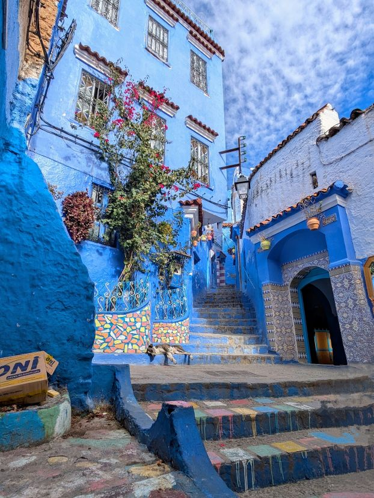
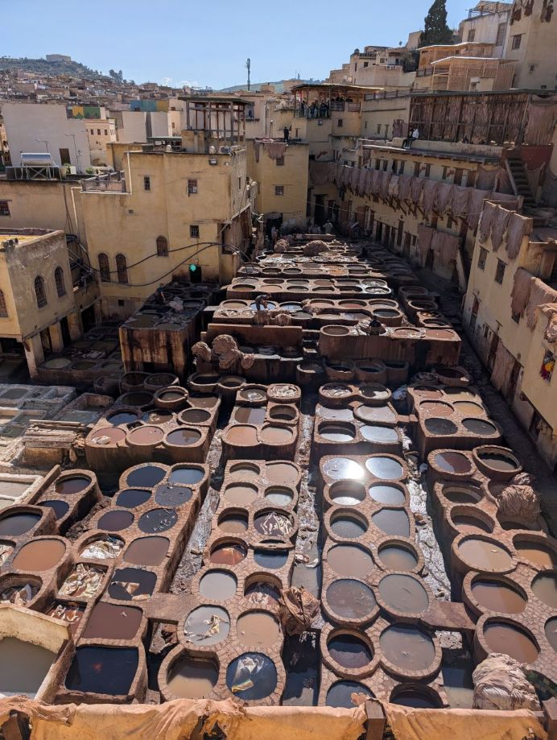
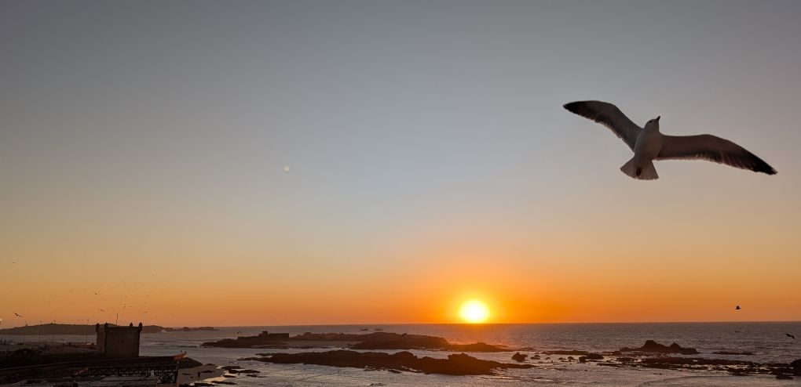
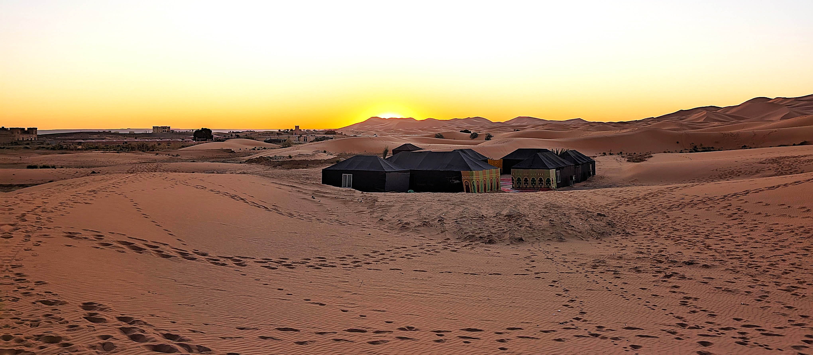

## The Underlying Thread — Morocco and Adaptation

Morocco is a country that has long connected worlds.

For centuries, traders crossed deserts, sailors navigated Atlantic coastlines, caravans traversed mountain passes, and travelers carried ideas between Africa, Europe, and the Middle East. The movement of people shaped more than commerce. It shaped stories. Some stories emerged in mountain villages hidden within the Atlas Mountains. Others followed caravan routes stretching across the Sahara. Many grew through generations of travelers exchanging news, legends, and folklore at markets, caravanserais, and city squares.

Unlike myths tied to a single monument or landscape, Morocco's stories often traveled. They moved along trade routes. They crossed deserts. They followed the people who carried them. As the journey unfolded, that pattern appeared repeatedly. Tangier reflected centuries of cultural exchange at the gateway between continents. Chefchaouen revealed the influence of mountain communities that preserved distinctive traditions and identities. Fez carried the legacy of scholarship, craftsmanship, and learning that attracted visitors from across the Islamic world.

Farther south, the Sahara stretched toward the horizon, evoking stories of caravans, hidden wells, lost cities, and Djinn said to inhabit the spaces beyond ordinary understanding. At Aït Benhaddou, ancient trade routes converged beneath fortified walls that once welcomed merchants arriving from distant lands. Marrakesh transformed storytelling itself into an art form, nowhere more visible than in the traditions of Jemaa el-Fnaa, where tales passed between generations through spoken performance. Locations revealed themselves not as isolated destinations, but as chapters in larger journeys. The mountains connected communities. The desert connected continents. The stories connected both.

Looking back, the trip became less about individual places and more about understanding how movement shaped culture across centuries. Morocco was never simply a collection of destinations. It was a crossroads. And crossroads rarely accumulate only goods. They accumulate stories.

---

## The Myth Thread — Stories of the Road
## Atlas Mountain Legends

Long before roads crossed the High Atlas, Amazigh communities told stories about mountains that possessed their own character and spirit. Many peaks were viewed as places where the visible and invisible worlds met. Travelers spoke of hidden valleys protected from outsiders, sacred springs whose waters brought healing, and remote mountain passes where mysterious beings appeared to those who traveled alone.

The mountains themselves became characters in the stories. They sheltered communities during centuries of invasion and conflict, preserved traditions that might otherwise have disappeared, and provided refuge to those seeking independence.

Even today, villages seem to emerge naturally from the landscape, as though they belong to the mountains rather than merely occupying them. To many who lived there, the Atlas was never simply geography. It was a protector.

---

## Amazigh Heritage

The Amazigh, often called Berbers by outsiders, are among North Africa's oldest peoples. Their name for themselves, Amazigh, is often translated as "free people." Over thousands of years they developed languages, traditions, music, architecture, and oral histories closely tied to the landscapes they inhabited. Many Amazigh stories celebrate resilience, self-reliance, and the ability to adapt without losing identity. Empires arrived and departed. Borders changed. Languages spread.

Yet mountain villages and desert communities continued preserving customs passed from generation to generation. In many ways, their greatest legend is not a single story but the survival of a culture across centuries of change.

## Djinn Traditions

Moroccan folklore is filled with stories of Djinn, supernatural beings said to have been created from smokeless fire. Unlike angels, Djinn possess free will. They can help or mislead, protect or deceive, remain hidden or reveal themselves. Stories place them in abandoned ruins, remote caves, lonely wells, desert crossings, and places where travelers feel most vulnerable.

Many tales describe unusual sounds carried by the wind, mysterious encounters after dark, or travelers becoming lost in areas believed to be inhabited by unseen forces. 

While modern readers may view these stories as folklore, they often served practical purposes as well.

A dangerous cave, an unreliable well, or an isolated stretch of desert became easier to remember when attached to a supernatural warning. The stories transformed caution into memory.

## Caravan Myths

For centuries, vast caravans crossed the Sahara carrying salt, gold, ivory, spices, textiles, manuscripts, and ideas between distant worlds. The journeys were long, dangerous, and frequently unpredictable.

Travelers navigated by stars and experience across landscapes where landmarks could disappear overnight beneath shifting sand. Not surprisingly, myths flourished.

Stories told of phantom caravans appearing on the horizon only to vanish without explanation. Some spoke of invisible guides leading lost travelers toward water. Others warned of wandering spirits that tempted merchants away from established routes. 

The desert's immense scale blurred the line between reality and imagination. A mirage could look like a city. A sandstorm could erase entire tracks. The Sahara became a landscape uniquely capable of generating legends.

## Lost Cities Beneath the Sands

Among the most enduring Saharan stories are legends of lost cities. Some tales describe prosperous settlements swallowed by the desert after their inhabitants became greedy or abandoned sacred obligations. Others tell of forgotten kingdoms buried beneath the dunes, waiting to be rediscovered.

These stories were reinforced by reality. Ancient caravan routes shifted. Settlements were abandoned. Ruins emerged and disappeared as the desert moved around them. 

Travelers occasionally encountered remnants of earlier civilizations in places that seemed impossibly remote. As a result, myths of hidden cities persisted long after their origins were forgotten. The desert itself became a keeper of secrets.

## Storytelling Traditions of Marrakesh

If the Sahara carried stories across the landscape, Marrakesh preserved them. For generations, storytellers gathered in Jemaa el-Fnaa, the city's famous central square, drawing crowds with tales of heroes, saints, tricksters, merchants, lovers, and supernatural beings.

The performances were not simply entertainment. They were a living archive. History mixed with folklore. Wisdom mixed with humor.

Each storyteller adapted the narrative, ensuring the stories remained relevant to new audiences. Long before books became common, stories traveled through memory and performance.

In many respects, Marrakesh became the crossroads where Morocco's countless legends converged. Travelers arrived from distant places carrying new stories. Storytellers transformed them into part of a larger cultural tradition.

## Transition

Taken together, these stories reveal a recurring theme. Myths became attached to journeys. The mountains protected them. The desert carried them. The storytellers preserved them.

And generation after generation, travelers added new chapters to the road.

---

## The Journey

Morocco revealed itself through variation rather than arrival. The country shifted character easily — sometimes within the space of a single day — without ever feeling unstable. Perspective kept adjusting, not because the landscape demanded it, but because movement made it unavoidable.

The entry carried density without hostility. Streets moved with confidence guided by habit rather than urgency. It was busy, but practiced. Nothing demanded explanation. Morocco did not present itself — it operated, already in motion.

Leaving the city loosened the frame. Roads stretched toward the Atlas, and space began to separate itself into planes. Towns appeared as pauses rather than destinations. The landscape widened without insistence, and travel became a way of thinking — a gradual release from accumulation.

Along the way, adaptation showed itself quietly. Argan trees stood scattered across the land, gnarled and deliberate. Stories followed — goats once climbing into the branches for nuts, an image that traveled far before being corrected, restrained, and learned from. Morocco did not seem concerned with nostalgia for itself. It adjusted. It continued.

Chefchaouen shifted the register again.

The blue repeated until it stopped feeling decorative. Color became structure — wrapping walls, steps, corners, and alleys into coherence. Movement slowed naturally. Walking replaced navigating. The city did not urge forward motion. It invited attention. Looking became sufficient.

Beyond the hills, the land opened further and thinned without becoming barren. The desert arrived gradually — not as spectacle, but as absence. Travel adjusted its pace once more. Camels set the rhythm. Forward progress mattered less than continuity. Time lengthened. Sound loosened its grip.

Night in the desert did not perform. It held.

Silence persisted. Stars arrived without emphasis. Morning came without alteration. The experience was not about seeing more, but about remaining — long enough for scale to register without commentary.

Before another dawn, distance returned in a different form.

The balloon rose gently as light thinned the dark. From above, Morocco simplified itself. Fields resolved into quiet geometry. Roads curved with intention. Settlements appeared integrated rather than imposed. What had been walked, driven, and ridden compressed into pattern. The view offered no revelation — only confirmation.

Distance ordered what proximity had complicated.

Back on the ground, life resumed without acknowledgment. Markets opened. Roads filled. Work continued. The weather remained generous — cool mornings, clear days — allowing attention to persist without strain. Morocco did not overwhelm. It accumulated.

Understanding settled most clearly in the kitchen.

The cooking school stripped away abstraction. Food here was not presentation, but practice. Spices were handled, not romanticized. Techniques were demonstrated without explanation, then repeated until they made sense. Measurement followed experience, not precision.

Cooking collapsed the country into the hands.

Flavors carried geography. The conversations around preparation revealed rhythm rather than instruction. What architecture suggested, food confirmed: Morocco is sustained by what is done daily, carefully, and without display.

Participation revealed more than observation ever could.

By the end, no single image claimed authority. What remained instead was range — how Morocco moved between elevation and ground, silence and density, distance and intimacy, without losing coherence.

The country did not ask to be concluded. It allowed meaning to settle.

---

## The Route (Context)

**15 Days**

Casablanca → Tangier → Chefchaouen → Rabat → Volubilis & Meknes → Fez → Erfoud → Sahara (Merzouga) → Aït Benhaddou → Marrakesh → Essaouira → Casablanca

The route mattered not because of the stops themselves, but because of how each transition changed the pace of the days.

---

## The Itinerary (Reference)

<strong>Morocco at a Glance</strong>

---

- **Day 1: Arrive in Casablanca and settle in with a free afternoon.**

- **Day 2: Visit Tangier and the blue-washed streets of Chefchaouen.**

- **Day 3: Free day in Casablanca for exploration or relaxation.**

- **Day 4: Explore Rabat, including Hassan Tower, Kasbah of the Udayas, and Andalusian Gardens.**

- **Day 5: Tour Volubilis and Meknes, then continue to Fez.**

- **Day 6: Discover the historic medina, tanneries, and cultural landmarks of Fez.**

- **Day 7: Cross the Middle Atlas Mountains via Ifrane and Midelt to Erfoud.**

- **Day 8: Visit Rissani and journey into the Sahara Desert for an overnight camp experience.**

- **Day 9: Travel through Todra Gorge to Aït Benhaddou.**

- **Day 10: Explore Aït Benhaddou and cross the High Atlas to Marrakesh.**

- **Day 11: Tour Marrakesh highlights including Majorelle Gardens, Bahia Palace, and Djemaa el-Fna.**

- **Day 12: Open day in Marrakesh with optional sunrise hot-air balloon ride.**

- **Day 13: Take a Moroccan cooking class before heading to the coastal town of Essaouira.**

- **Day 14: Enjoy Essaouira’s medina, fishing port, and evening Gnawa music.**

- **Day 15: Return to Casablanca, including a visit to the Hassan II Mosque.**

-,**Day 16: Depart Morocco.**

---

<strong>View full day‑by‑day itinerary</strong>

**Day 1 · Arrival → to Rabat on Day 4**  
Arrive in Casablanca. The afternoon is unstructured — time to walk, orient, and adjust.  

**Day 2 · Tangier & Chefchaouen**  
Travel to Morocco’s northern edge, where Europe feels only an arm’s length away.  
Begin in **Tangier** — whitewashed cliffs, sea light, and the blend of Spanish, Moroccan, and Mediterranean influences that always feels slightly unreal.  
Continue inland to **Chefchaouen**, the Blue City, where everything slows: indigo steps, painted alleys, cats asleep in doorways. It’s an easy place to exhale and let the trip begin gently.  

**Blue City Pic**

**Overnight:** back in Casablanca

---

**Day 4 · Rabat**  
A guided exploration of Morocco’s capital: Royal Palace area, Bab Rouah, Hassan Tower, Kasbah of the Udayas, and Andalusian gardens.  
**Overnight:** Rabat

---

**Day 5 · Volubilis & Meknes → Fez**  
Travel inland to the Roman ruins of Volubilis, continue to Meknes to see Bab Mansour, and arrive in Fez.  
**Overnight:** Fez

---

**Day 6 · Fez**  
A full day in Fez’s medina — Bab Boujloud, workshops, madrassas, tanneries, and the mellah.  
  
**Tannery Pic**  

**Overnight:** Fez

---

**Day 7 · Middle Atlas → Erfoud**  
Cross Ifrane and Midelt before descending into the desert landscape surrounding Erfoud.  
**Overnight:** Erfoud

---

**Day 8 · Rissani → Sahara Camp**  
Visit Rissani, meet locals in a Berber tent, and ride into the Sahara dunes.  
  

**Overnight:** Sahara camp (Merzouga)

---

**Day 9 · Todra Gorge → Aït Benhaddou**  
Drive through Todra Gorge, then continue west toward the fortified ksar of Aït Benhaddou.  
**Overnight:** Aït Benhaddou / Ouarzazate region

---

**Day 10 · Aït Benhaddou → Marrakesh**  
Explore the ksar, then cross the High Atlas into Marrakesh.  
**Overnight:** Marrakesh

---

**Day 11 · Marrakesh**  
Majorelle Gardens, Koutoubia, Bahia Palace, Saadian Tombs, and Djemaa el‑Fna.  
**Overnight:** Marrakesh

---

**Day 12 · Marrakesh (Open Day)**  
Optional sunrise hot‑air balloon flight (see link) or open exploration.  
- [Balloon Ride](/story-content/morocco-before-sunrise.html)
**Overnight:** Marrakesh

---

**Day 13 · Marrakesh → Essaouira**  
Cooking class in a riad, then west to young coastal winds and open space.  
**Overnight:** Essaouira

---

**Day 14 · Essaouira**  
Medina, port, fish market, and Gnawa music in the evening.  
  
**Overnight:** Essaouira

---

**Day 15 · Essaouira → Casablanca**  
Drive north to Casablanca with a city overview including the Hassan II Mosque.  
**Overnight:** Casablanca

---

**Day 16 · Departure**  
Transfer to the airport and depart Morocco.

---

**Sunrise at the Camp Pic**

---

## Afterthoughts

This wasn’t a trip of highlights. It was a movement through registers — city, mountain, desert, kitchen, distance — and the way those registers shift how attention works. Morocco doesn’t unfold in a single direction. It recalibrates constantly.

**On movement.**  
Morocco moves laterally. Roads across the Atlas widened understanding rather than advancing toward a goal. Camels reset time completely — pace became continuity, not progress. The desert overnight worked because it lasted long enough to stop feeling notable.

**On distance.**  
The balloon simplified rather than explained. Fields became geometry. Settlements read as integrated rather than imposed. Distance ordered what proximity complicated, without claiming authority over it.

**On color and restraint.**  
Chefchaouen worked by limiting itself. Blue wasn’t decoration — it was structure. Repetition slowed movement and rewarded looking over coverage.

**On practice.**  
Meaning arrived most clearly in the kitchen. Cooking collapsed abstraction into the hands. Spices were handled, not narrated. Technique revealed geography more clearly than explanation.

**On adaptation.**  
The argan tree stories mattered less as image than as correction. What once existed was adjusted. Morocco showed little interest in preserving a version of itself for display.

**On pace (what worked).**  
Late winter softened everything — temperature, endurance, attention. Covering ground worked because it never competed aggressively. The desert night acted as a true exhale.

**If we did it again.**  
Keep one night in the desert — exactly one. Anything more would dilute the quiet that makes it work.  
Hold Chefchaouen as a full, unplanned day again, but pair it with a brief reach toward the Mediterranean to extend the contrast.  
Let the cooking school run long; conversation matters as much as instruction.  
Protect unscheduled mornings whenever possible.

**What stayed.**  
Textures more than scenes: cooled air before dawn, blue pigment softening stone, spices staining fingertips, the steady realization that variation does not require disruption.

This wasn’t a trip about seeing Morocco.  
It was a trip about learning how differently a place can move — without ever losing itself.

---

### Field photographs from the Morocco journey
  
[View the photo archive](/photo-archive/#morocco)

---

## More Field Notes
See other movements across landscapes:

- [Travel Index](/travel/)

- [Atlas Index](/atlas/)

