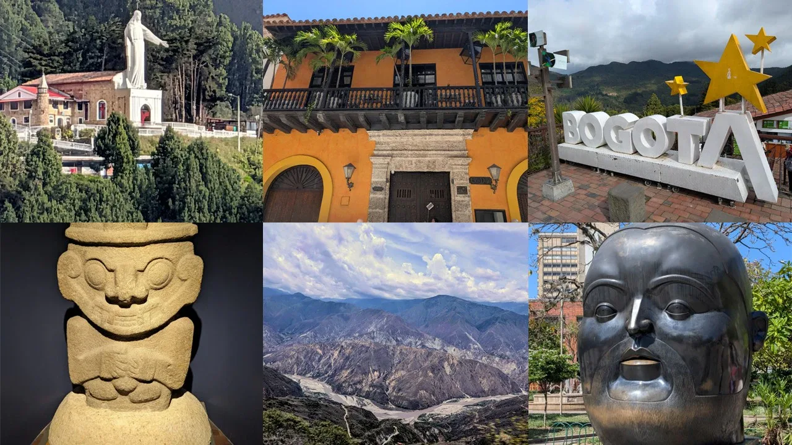
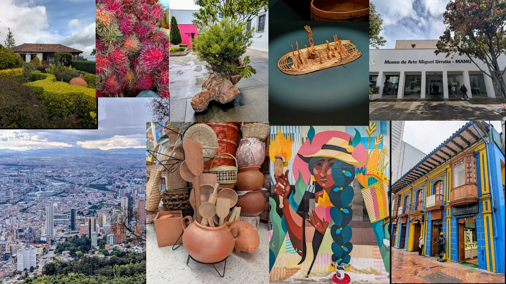
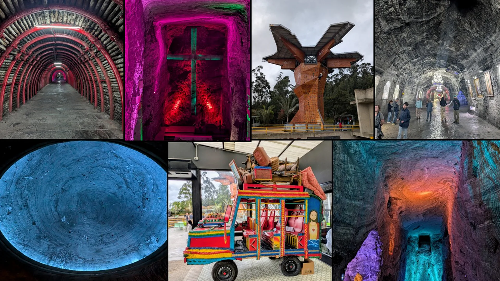

Some countries reveal themselves quickly. Others take time. Colombia belonged firmly in the second category.

At first, the journey appeared difficult to define. The route crossed mountain cities, colonial towns, coffee farms, artisan workshops, canyon landscapes, vibrant urban neighborhoods, and Caribbean coastlines.

The places shared little on the surface. Bogotá looked nothing like Barichara. Barichara looked nothing like Medellín. Medellín looked nothing like Cartagena.

The geography changed. The architecture changed. The culture changed. Even the pace of life seemed to change from place to place.

Yet a common thread gradually emerged. Not immediately. Gradually.

Again and again, places revealed themselves not through what they had been, but through what they were becoming.

A salt mine became a cathedral. Ancient paths continued guiding modern travelers. Traditional craftsmanship remained relevant in contemporary communities. Cities worked to redefine themselves through connection, education, and public space. Communities adapted to new realities while remaining rooted in older ones.

Looking back, the journey became less about destinations and more about understanding how people, communities, and places continue evolving while remaining connected to what came before.

---

## The Route (Context)

Bogotá → Zipaquirá → Villa de Leyva → Barichara → Guane → Chicamocha Canyon → Bucaramanga → Medellín → Cartagena → La Boquilla

A movement through mountains, colonial towns, artisan traditions, agricultural landscapes, transformative cities, Afro-Colombian communities, and Caribbean coastlines.

The route crossed regions shaped by different histories, cultures, and geographies.

The distances mattered. The transitions mattered more.

---

## The Myth Thread — Transformation

Some countries tell their story in monuments. Colombia tells it in transformations.

The Andes split and fold across the landscape, turning a single nation into many worlds. Rainforest becomes mountain. Mountain becomes coffee country. Coffee country gives way to cities, coastlines, deserts, and jungle. Nothing stays only one thing for long. History follows the same pattern.

For generations, Colombia carried stories of conflict that became its identity in the eyes of outsiders. Yet beneath those headlines, something else was happening. Communities endured. Traditions survived. Beauty persisted. What looked broken from a distance was quietly rebuilding itself from within.

The myth thread of Colombia is alchemy.

The ability to take adversity and turn it into something life-giving. Coffee growers transform steep volcanic slopes into abundance. Musicians transform hardship into rhythm. Artists transform memory into color. Families transform ordinary gatherings into celebrations that spill into streets and plazas. Even nature participates. Rivers carve mountains. Forests reclaim what is abandoned. Life erupts from places where it should not.

Colombia does not pretend the past never happened. It carries it forward and turns it into something new. That may be its deepest lesson:

Transformation is not forgetting. Transformation is remembering, and choosing what comes next.

Three days before we arrived, an earthquake rattled the region around Cali. It was a reminder that Colombia is still being shaped. Mountains are still rising. Rivers are still carving valleys. The landscape itself remains unfinished. Perhaps that's why transformation feels woven so deeply into the country's character. In Colombia, change is not an interruption of the story. Change is the story.

## The Alchemy of El Dorado

Perhaps nowhere is the relationship between transformation and perception more visible than in the legend of El Dorado. Today, many imagine El Dorado as a lost city of gold hidden somewhere beyond the horizon. That was not how the story began. Its origins lie among the Muisca, one of the advanced societies that inhabited the highlands surrounding present-day Bogotá.

When a new ruler assumed power, tradition describes a ceremony at Lake Guatavita. Covered in fine gold dust until he appeared to glow in the sunlight, the leader traveled by raft to the center of the lake. There he offered precious objects to the waters as gifts to the divine.

The ruler became known as El Dorado. Not a city. Not a kingdom. A man. The Gilded One.

Yet stories rarely remain unchanged. As reports spread beyond the Andes, each retelling added another layer. A gilded ruler became a wealthy chief. A wealthy chief became a kingdom. A kingdom became a city. A city became an empire overflowing with unimaginable riches. The transformation was remarkable. The gold remained the same. The meaning changed entirely.

Spanish explorers, conquistadors, adventurers, and fortune-seekers crossed mountains, jungles, rivers, and plains searching for a place that existed largely in their own imaginations. Entire expeditions disappeared into landscapes they scarcely understood. Fortunes were spent. Lives were lost. Maps were redrawn. All in pursuit of a story.

In many ways, El Dorado became one of history's greatest examples of alchemy. Not because gold was produced. Because an idea was transformed. A sacred ceremony became an international obsession. A local tradition became a global myth. Reality became legend.

The deeper irony is that Colombia never needed a city of gold to be extraordinary. The landscapes were already remarkable. The cultures were already rich. The communities already possessed stories worth telling. The real treasure was never hidden beneath a jungle canopy or buried beneath a lake. It existed in the people and places that continued evolving long after the legends were created.

## The Philosopher's Stone

Alchemists searched for the Philosopher's Stone. Not simply because it promised wealth. Because it promised perfection through transformation.

A final stage in a continuous process of refinement. Perhaps that helps explain why Colombia felt so difficult to summarize at first. The journey was not defined by a single monument, landscape, or historical event. Instead, it seemed connected by an ongoing process. Places adapting. Communities evolving. Traditions persisting while changing form. Nothing felt frozen in time. Everything felt alive.

---

## The Itinerary (Reference)

<strong>View full day-by-day itinerary</strong>

---

### Day 1 — Transit

Baltra Island → Guayaquil

Arrival in Ecuador's coastal gateway after the Galápagos.

Overnight: Sheraton Guayaquil

---

### Day 2 — Bogotá

Guayaquil → Bogotá

Monserrate overlooking Bogotá

Welcome dinner and introduction to Colombia

Overnight: Sofitel Bogotá

---

### Day 3 — Layers of Bogotá

Plaza de Bolívar

Gold Museum

Botero Museum

La Concordia Market

Traditional Colombian cuisine

Overnight: Sofitel Bogotá

---

### Day 4 — Salt and Stone

Bogotá → Zipaquirá → Villa de Leyva

Salt Cathedral of Zipaquirá

Andean countryside

Arrival in Villa de Leyva

Overnight: Hotel Campanario de la Villa

---

### Day 5 — Villa de Leyva

Plaza Mayor

Antonio Nariño Museum

Antonio Ricaurte Museum

Artisan wool weaving workshop

Tejo

Overnight: Hotel Campanario de la Villa

---

### Day 6 — Barichara

Villa de Leyva → Barichara

Colonial architecture

Earth painting workshop

Tapia Pisada earthen construction

Overnight: Hotel Terra Barichara

---

### Day 7 — Guane

Tuk Tuk to Guane

Camino Real

Traditional countryside communities

Chiva ride

Overnight: Hotel Terra Barichara

---

### Day 8 — Coffee and Canyon

Coffee farm experience

Chicamocha Canyon

Arrival in Bucaramanga

Overnight: Hotel Dann Carlton Bucaramanga

---

### Day 9 — Cacao and Medellín

Cacao farm

Chocolate tasting

Flight to Medellín

Overnight: Hotel Quinta Ladera

---

### Day 10 — Medellín

Berrío Park

Tram and Metrocable

Manrique neighborhood

Community art

Pablo Escobar Museum

Overnight: Hotel Quinta Ladera

---

### Day 11 — Cartagena

Medellín → Cartagena

Historic Walled City

Bolívar Park

San Pedro Claver

Overnight: Hotel Casa Don Luis

---

### Day 12 — La Boquilla

Mangrove excursion

Mangrove restoration project

Drumming workshop

Cooking experience

Casa Italia Foundation

Rum and chocolate tasting

Overnight: Hotel Casa Don Luis

---

### Day 13 — Cartagena

Independent day.

An eye infection changed several plans, including a scheduled visit to San Basilio de Palenque. The slower day ultimately became an opportunity to experience Cartagena without an agenda.

Overnight: Hotel Casa Don Luis

---

### Day 14 — Departure

Cartagena → Panama City → Houston

Return home.

---

---

## Bogotá — Layers

From Monserrate, the city seemed to extend to the horizon in every direction, disappearing into a haze where mountains and buildings became difficult to separate. Traffic moved far below while clouds drifted across the ridgeline behind us.

The historic center revealed one layer. Plaza de Bolívar revealed another.

The Gold Museum introduced civilizations that existed long before modern Colombia emerged, while the Botero Museum demonstrated how contemporary artists continue interpreting the country's culture and history through a different lens.

Bogotá provided the first clue. Bogotá resisted simplification. It introduced many Colombias existing at the same time.

---

## Zipaquirá — Transformation of Purpose

Before arriving, it was difficult to understand how a mine could become one of Colombia's most compelling spaces.

Inside, the transition felt remarkably natural.

The chambers remained underground. The walls remained salt. Evidence of labor remained visible everywhere. Yet the purpose had changed entirely. The experience was memorable not because of its scale, but because of its reinterpretation.

The cathedral acknowledged its origins without being constrained by them. The mine remained visible. Its purpose evolved.

---

## Villa de Leyva — Continuity

As dusk settled over Villa de Leyva, the mood of the plaza shifted without ever becoming quiet. 

A cool breeze swept across the square beneath a cloudy sky while children continued playing during National Kite Day celebrations. Vendors lingered around the edges of the plaza selling food, drinks, and local artwork, their stands illuminated by the last light of the evening. 

Nothing felt staged for visitors. The scene felt like a community gathering in a place that had been serving the same purpose for generations.

---

## Barichara — Craft

Barichara expanded on that idea through craft.

Built largely from warm yellow stone and earthen materials, the town appeared shaped as much by local knowledge as by architecture. The Earth Painting workshop made that connection tangible. Using pigments derived from the surrounding landscape, the exercise demonstrated how local materials continue influencing artistic traditions today.

That relationship between place and community reaches deep into the town's history. Local tradition traces Barichara's origins to the "Miracle of the Stone," when a peasant reportedly discovered the image of the Virgin Mary on a rock in 1702. The event inspired the eventual construction of the Cathedral of the Immaculate Conception, which still anchors the town's central square. 

The story felt consistent with the character of Barichara itself. Stone was not simply a building material. It appeared everywhere: in streets, walls, churches, workshops, and public spaces. The town seemed built from the landscape rather than imposed upon it.

Techniques survived not because they had been preserved in books, but because people continued using them. Each wall represented more than construction. It represented accumulated experience.

The town itself seemed built from continuity.

---

## Guane — Ancient Paths

The journey to Guane began in a tuk-tuk departing Barichara beneath clear skies and bright sunshine. The road wound through gentle hills and open countryside as a cool breeze moved through the vehicle's open sides. The pace felt appropriate for the landscape, allowing the details of farms, stone walls, and rolling terrain to unfold gradually rather than rush past.

Arriving in Guane felt like stepping into a quieter rhythm. The small plaza and historic church remained the center of village life, surrounded by a landscape that seemed little changed by time.

The Camino Real revealed another kind of inheritance. The route existed long before modern transportation and long before modern Colombia. While today's travelers arrive by road, the historic path still reflects centuries of movement across the region.

Looking across the surrounding countryside, it became easier to understand how certain routes continue shaping communities generation after generation. The landscape changed little. The travelers changed constantly.

The Camino Real felt like a reminder that some connections endure because they remain useful long after the world around them changes.

---

## Coffee, Cacao, and Chicamocha

In Santander, the focus shifted toward cultivation.

Coffee and cacao begin as agriculture. What emerges becomes culture. The process requires climate, elevation, patience, experimentation, and knowledge accumulated over generations. The farms demonstrated how communities transform landscape into identity.

The Chicamocha Canyon provided a dramatic counterpoint. The first view seemed to stretch endlessly across the horizon, revealing a landscape shaped on a scale that was difficult to fully comprehend. Under sunny skies and a warm breeze, the canyon unfolded mile after mile, its steep walls emphasizing the immense difference in elevation between the rim and the valley floor.

The cable car offered the best perspective. Suspended above the canyon, the landscape appeared to open in every direction while colorful hang gliders drifted in the distance. The descent carried us from the rim toward the valley below, revealing just how deep the canyon truly was. Looking back during the return climb, the steep elevation changes felt even more impressive than they had from the viewpoints above.

The farms represented what people build. The canyon represented what nature builds over time.

Both felt necessary to understanding the region.

---

## Medellín — Becoming

Few destinations carried stronger assumptions before arrival than Medellín.

Long before the trip began, the city already existed through stories. News reports. Documentaries. Books. Television series.

A visit to the Pablo Escobar Museum revealed how powerfully a single narrative can shape outside perceptions of a place. The museum explained one chapter. The city itself revealed another.

Public transportation connected communities once isolated by geography. The Metrocable transformed access. Neighborhoods previously associated with conflict displayed public art, local investment, and community pride.

The contrast was impossible to miss. Neither story erased the other. Both remained part of the same city.

That tension became one of the most compelling observations of the journey. Medellín did not appear interested in denying its history. It seemed more interested in demonstrating that history would not entirely define its future.

---

## Cartagena — Memory

Cartagena offered another perspective.

The walled city preserved physical reminders of colonial power, trade, culture, and conflict. Buildings endured. Meanings shifted.

Walking the streets felt like moving through layers of memory. Some celebrated. Some difficult. Some unresolved.

What remained impressive was not preservation itself. It was the willingness to continue engaging with what had been preserved.

---

## La Boquilla — Community

The final days introduced a more personal scale.

In La Boquilla, mangrove restoration, drumming traditions, cooking, and community projects demonstrated how culture survives through participation rather than presentation. Nothing felt staged. The experiences reflected practices that remained relevant to the community itself.

The day concluded with a rum and chocolate tasting at El Arsenal. What began as a simple introduction to Colombian products became something more interesting. Each rum reflected different regions, ingredients, climates, and production methods. The chocolate carried similar distinctions.

The products were excellent. The lesson was more interesting. Flavor became another way of understanding place.

The most memorable insight came not from a monument, but from participation.

---

## What Stayed

Before the trip, Colombia often appeared through a handful of familiar narratives. Some historical. Some political. Some shaped by headlines. The journey complicated all of them.

What remained afterward was not a single image or destination, but a growing resistance to simple explanations. Bogotá felt different from Barichara. Barichara felt different from Medellín. Medellín felt different from Cartagena. Each revealed a different version of the country.

The diversity itself was not surprising. The connections between those differences were.

Again and again, people built upon what already existed rather than discarding it. Whether through architecture, agriculture, transportation, craft, or community, the most memorable examples rarely involved starting over.

Perhaps that was the most unexpected observation. The farther the journey progressed, the harder Colombia became to summarize. That felt less like a problem and more like a success.

---

## If We Did It Again

We would leave more room for the unexpected.

The itinerary introduced mountain towns, colonial cities, coffee farms, artisan workshops, growing urban centers, and Caribbean communities. The structure was excellent. The surprises were better. Some of the most memorable moments were not the locations themselves. They were the conversations. The workshops. The stories shared by guides, farmers, artisans, and residents.

Villa de Leyva and Barichara rewarded slowing down. The plazas, workshops, streets, and surrounding landscapes revealed themselves gradually. More time there would have been welcome.

Cartagena is the place we would most intentionally revisit. An illness late in the trip unexpectedly changed several plans and reduced our opportunity to simply wander. The historic center felt like a city best experienced without an agenda. Its streets, balconies, plazas, cafés, shops, and evening atmosphere invited exploration rather than completion. There was a sense that Cartagena still had stories left to tell.

The biggest change, however, would not involve adding destinations. It would involve adding time.

The strongest insights came through participation. The workshops. The agricultural visits. The community projects. The shared meals. The local conversations.

If we returned, we would build the trip around more of them. The destinations introduced Colombia. The people explained it.

---

## Places That Kept Changing

Traveling through Colombia revealed a similar pattern. Places evolved without losing their connection to what came before.

In Zipaquirá, a salt mine became a cathedral. In Villa de Leyva, centuries-old architecture remained part of a living community rather than a preserved relic. In Barichara and Guane, traditional crafts continued adapting to modern life while retaining connections to earlier generations.

Even Medellín, perhaps the most striking example, transformed itself through education, infrastructure, public spaces, and social investment, creating a narrative very different from the one many outsiders once associated with the city. The locations differed. The pattern remained. Transformation without disconnection.

---

## Why the Theme Endures

The real lesson of alchemy was never about gold. It was about possibility. The belief that change does not require abandoning what came before. That transformation can preserve as much as it reshapes.

Looking back, that idea appeared repeatedly throughout the journey. Not in laboratories. Not in legends. But in the communities, landscapes, and traditions encountered along the way.

---

### Field photographs from this journey:

[View the photo archive](/photo-archive/#columbia)

---

## More Field Notes
See other movements across landscapes:

- [Travel Index](/travel/)

- [Atlas Index](/atlas/)

